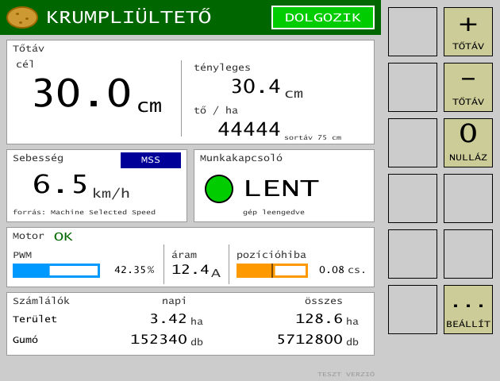
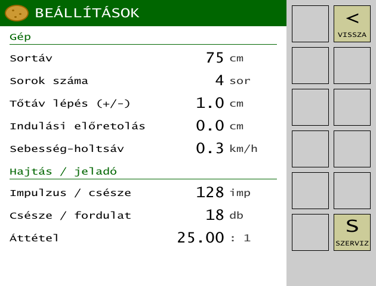
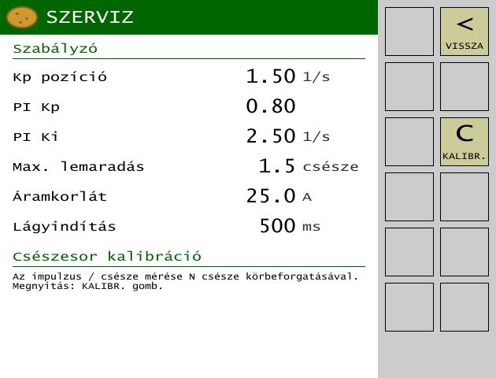
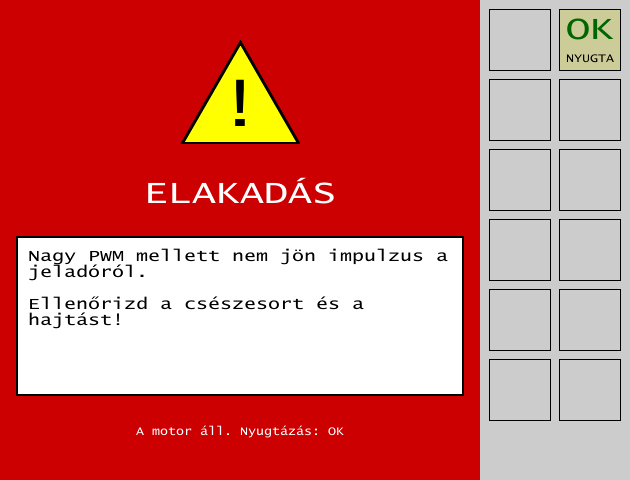
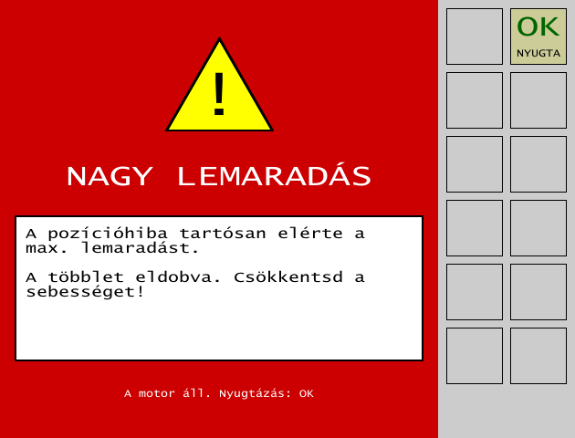
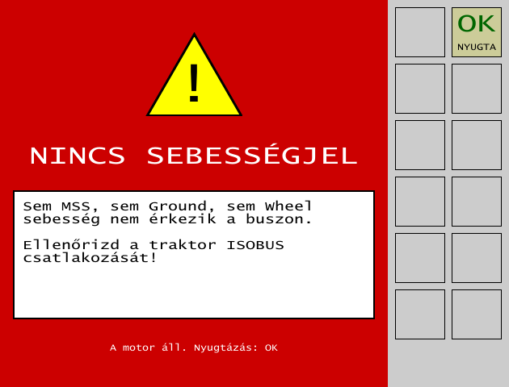
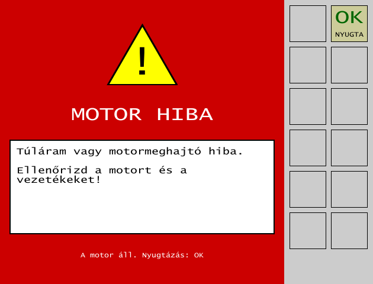

# AgIso krumpliültető vezérlő

> ⚠️ **Teszt fázis.** Ez egy készülő projekt, egyelőre csak a VT felület mintája és a tervezési jegyzet van kész.
> Nincs még firmware, nem volt gépen kipróbálva, és bármi változhat. Éles munkára ne használd.

Saját ISOBUS implement ECU egy krumpliültetőhöz: egy villanymotor hajtja az adagoló csészesort, a motor
pozícióját a megtett távolsághoz kötjük („elektronikus fogaskerék”), a sebesség és a távolság a traktor
ISOBUS buszáról jön (MSS → Ground → Wheel). A felhasználó a tőtávolságot adja meg cm-ben.

A részletes tervezési jegyzet: [docs/krumpliulteto-vezerlo.md](docs/krumpliulteto-vezerlo.md).

## Mi van a repóban

| Útvonal | Tartalom |
|---|---|
| [`pool/krumpliulteto.iop`](pool/krumpliulteto.iop) | A VT object pool (ISO 11783-6, VT 4), generált |
| [`include/krumpli_pool_ids.hpp`](include/krumpli_pool_ids.hpp) | Objektum-azonosítók és softkey kódok a firmware-nek, generált |
| [`tools/make_pool.py`](tools/make_pool.py) | A pool és a header generátora (Python 3.10+, csak standard könyvtár) |
| [`render/`](render/) | vt-render képek a poolról |
| [`docs/`](docs/) | Tervezési jegyzet |

## VT felület

A pool 480 × 480-as adatmaszkra és 60 × 60-as softkey-ekre készült, a szövegek magyarul, ISO 8859-2
kódolással (font type 2), így az ő és ű is helyesen jelenik meg. A kijelzett értékek mintaértékek.

### Munkaképernyő



Cél tőtáv (bevihető), tényleges tőtáv, tő/ha, sebesség és forrása, munkakapcsoló, motor állapot,
PWM (0,01 %) és áram (0,1 A), pozícióhiba, napi és összes terület és gumószám.
Softkey-ek: tőtáv +/−, számlálók nullázása, beállítások.

### Beállítások és szerviz

| Beállítások | Szerviz |
|---|---|
|  |  |

Beállítások: sortáv, sorok száma, tőtáv lépés, indulási előretolás, sebesség-holtsáv, impulzus/csésze,
csésze/fordulat, áttétel. Szerviz: szabályzó paraméterek (Kp pozíció, PI, max. lemaradás, áramkorlát,
lágyindítás) és forgatásos kalibráció.

### Riasztások

| Elakadás | Nagy lemaradás |
|---|---|
|  |  |
| **Nincs sebességjel** | **Motor hiba** |
|  |  |

## Pool újragenerálása

```sh
python tools/make_pool.py
```

Ez felülírja a `pool/krumpliulteto.iop` és az `include/krumpli_pool_ids.hpp` fájlt. A generátor
ellenőrzi, hogy nincs-e duplikált objektum-azonosító és hogy minden hivatkozott objektum létezik.

### Renderelés

A képek az [AgIsoVirtualTerminal](https://github.com/Open-Agriculture/AgIsoVirtualTerminal) `vt-render`
eszközével készültek:

```sh
vt-render --pool pool/krumpliulteto.iop --out render
```

## Firmware oldal

A firmware (még nincs meg) az `include/krumpli_pool_ids.hpp` azonosítóit használja, például:

- tőtáv beállítás: `IN_TARGET_SPACING` (mm-ben tárolva, cm-ben kijelezve),
- értékfrissítés *Change Numeric Value* paranccsal: `OUT_SPEED`, `OUT_SEEDS_PER_HA`, `OUT_MOTOR_CURRENT`, …,
- motor PWM: a `VAR_MOTOR_PWM` number variable (0,01 %, 0–10000) frissítése egyszerre mozgatja a sávot és a számot,
- állapotszöveg *Change String Value* paranccsal: `OUT_STATUS_TEXT`, `OUT_SPEED_SOURCE`, `OUT_WORK_SWITCH_TEXT`,
- színváltás *Change Attribute* paranccsal: `OBJ_STATUS_BOX`, `OBJ_WORK_SWITCH_LED` → `FILL_GREEN` / `FILL_RED` / `FILL_GREY`,
- riasztás: *Change Active Mask* `AM_JAM`, `AM_LAG`, `AM_NO_SPEED` vagy `AM_MOTOR` maszkra, nyugtázás `KEY_ALARM_ACK_CODE`.

Az [AgIsoStack++](https://github.com/Open-Agriculture/AgIsoStack-plus-plus) VT klienssel tervezzük.

## Ütemterv

- [x] Tervezési jegyzet
- [x] VT object pool minta + renderek
- [ ] Firmware: VT kliens, sebesség/távolság olvasás, távolságkövető motorszabályzás
- [ ] Hardver: motor, meghajtó, jeladó kiválasztása (lásd a jegyzet 9. pontját)
- [ ] Később: TC-BAS, TC-SC, TC-GEO

## Licenc

[WTFPL](LICENSE)
